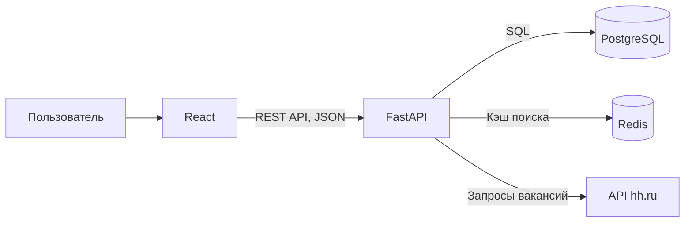

# Архитектура backend

Наш backend будет написан на Python с использованием FastAPI. Он связывает frontend, базу данных, Redis и внешний API вакансий.

## За что отвечает каждая часть

- **React** показывает вакансии и данные пользователя.
- **FastAPI** получает запросы от frontend и выполняет логику приложения.
- **PostgreSQL** хранит пользователей, вакансии, сохранения, отклики и историю статусов.
- **Redis** временно хранит результаты поиска, чтобы не запрашивать одни и те же данные слишком часто.
- **hh.ru API** предоставляет информацию о вакансиях.

Frontend обращается только к FastAPI. Backend сам работает с базой данных, кэшем и внешним API.

## Как работает поиск вакансий

1. Пользователь вводит запрос в приложении.
2. React отправляет запрос в FastAPI.
3. Backend проверяет, есть ли результат в Redis.
4. Если свежего результата нет, backend запрашивает вакансии у hh.ru и сохраняет ответ в Redis.
5. Backend возвращает результат frontend.

Свежесть кэша по проектному решению составляет 10 минут. Если hh.ru временно недоступен, backend может вернуть ранее сохранённый результат с отметкой `is_stale: true`. Если подходящего результата в кэше нет, возвращается ошибка.

## Как хранятся вакансии и отклики

У вакансии есть внешний идентификатор от hh.ru и внутренний идентификатор в нашей базе. При сохранении вакансии backend связывает её с аккаунтом пользователя.

Новый отклик получает начальный статус `applied`. При изменении статуса новая запись добавляется в историю. Статус и история должны сохраняться вместе, чтобы история не расходилась с текущим состоянием отклика.

Пароль пользователя хранится в виде хеша. Для закрытых запросов используется токен авторизации. Пользователь может просматривать и изменять только свои отклики, сохранения и напоминания.

Сервис помогает вести учёт откликов, но не отправляет резюме работодателю.