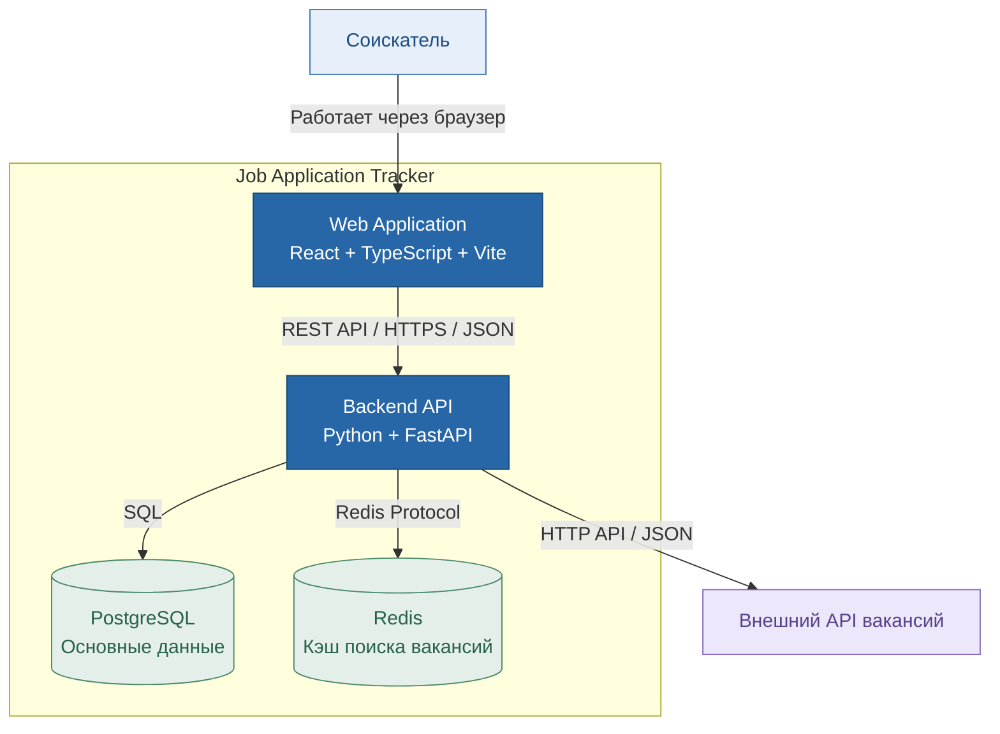

# C4 Level 2 — Container Diagram

## Назначение

Диаграмма описывает основные контейнеры системы
Job Application Tracker и их взаимодействие.

Архитектурный стиль — модульный монолит.

## Диаграмма



## Описание контейнеров

### Web Application

Технологии: React, TypeScript, Vite.

Обеспечивает пользовательский интерфейс для поиска
вакансий, сохранения вакансий и управления откликами.

Взаимодействует с Backend API через HTTP-запросы.

### Backend API

Технологии: Python, FastAPI.

Реализует бизнес-логику приложения:

- регистрация и авторизация пользователей;
- поиск и фильтрация вакансий;
- сохранение интересующих вакансий;
- управление откликами;
- изменение статусов откликов;
- хранение истории изменений;
- создание напоминаний;
- получение статистики.

### PostgreSQL

Основная реляционная база данных.

Хранит пользователей, вакансии, отклики, историю
изменения статусов и напоминания.

### Redis

Используется для кэширования результатов поиска
вакансий, полученных из внешнего API.

Позволяет уменьшить количество внешних запросов
и продолжить ограниченную работу поиска при
временной недоступности внешнего сервиса.

### Внешний API вакансий

Предоставляет информацию о доступных вакансиях.

Конкретный поставщик API будет зафиксирован
после проверки условий интеграции.

## Архитектурные решения

1. Backend реализован в виде модульного монолита.
2. Frontend взаимодействует только с Backend API.
3. PostgreSQL используется для постоянного хранения.
4. Redis применяется для кэширования внешних данных.
5. При недоступности внешнего API сохранённые отклики,
   статусы и история остаются доступными.
6. Контейнеризация выполняется через Docker Compose.
```
