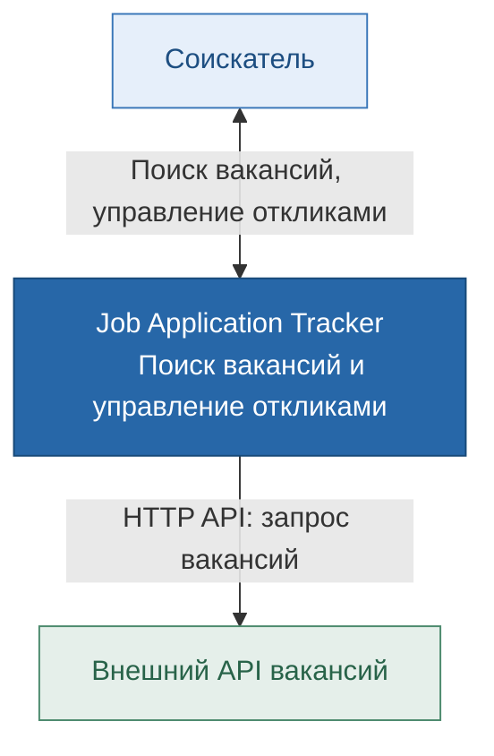

# C4 Level 1 — System Context

## Назначение

Job Application Tracker — веб-приложение для поиска вакансий
и управления процессом трудоустройства.

## Диаграмма контекста

## Описание взаимодействий

1. Соискатель использует Job Application Tracker для поиска
   вакансий и отслеживания откликов.
2. Система предоставляет функции сохранения вакансий,
   управления статусами, просмотра истории и статистики.
3. Система обращается к внешнему API вакансий для получения
   информации о предложениях работы.
4. При временной недоступности внешнего API система может
   использовать ранее кэшированные результаты поиска.
