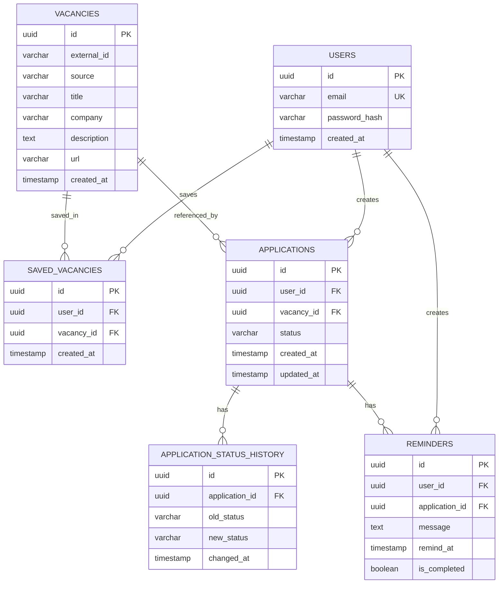

# ER-диаграмма — Job Application Tracker

## Назначение

База данных PostgreSQL предназначена для хранения
пользователей, вакансий, сохранённых вакансий,
откликов, истории статусов и напоминаний.

## ER-диаграмма



## Основные архитектурные решения

### Пользователи

Таблица `users` хранит учётные записи.
Email должен быть уникальным.
Пароли хранятся только в виде защищённых хешей.

### Вакансии

Таблица `vacancies` содержит локальные сведения
о вакансиях из внешнего API.

Пара `(source, external_id)` должна быть уникальной,
чтобы одна и та же внешняя вакансия не дублировалась.

### Сохранённые вакансии

Таблица `saved_vacancies` реализует связь
многие-ко-многим между пользователями и вакансиями.

Пара `(user_id, vacancy_id)` должна быть уникальной.

### Отклики

Таблица `applications` содержит текущий статус
отклика и ссылку на соответствующую вакансию.

Каждый отклик принадлежит определённому пользователю.

### История статусов

При изменении статуса отклика создаётся новая запись
в `application_status_history`.

Изменение текущего статуса и запись истории должны
выполняться в одной транзакции PostgreSQL.

### Напоминания

Напоминание принадлежит пользователю и связано
с конкретным откликом.

При создании напоминания система должна проверять,
что отклик принадлежит текущему пользователю.

## Индексы

Предусматриваются:

- уникальный индекс по `users.email`;
- уникальный индекс по `vacancies(source, external_id)`;
- уникальный индекс по `saved_vacancies(user_id, vacancy_id)`;
- индекс по `applications(user_id, updated_at)`;
- индекс по `application_status_history(application_id, changed_at)`;
- индекс по `reminders(user_id, remind_at)`.

Индексы помогают ускорить получение откликов
конкретного пользователя, их истории и напоминаний.

## Дополнительные ограничения

- Внешние ключи должны обеспечивать ссылочную целостность.
- Статусы откликов должны проверяться на допустимые значения.
- Время изменения статуса хранится в UTC.
- Удаление пользователей и связанных данных требует
  отдельной согласованной политики.
- Поля, необходимые для работы приложения, должны
  иметь ограничения NOT NULL.

## Масштабирование

Предполагается нагрузка от 10 000 уникальных
пользователей в сутки с возможным увеличением
до 100 000.

Выбор индексов будет дополнительно проверен
после расчётов Read/Write нагрузки и объёма данных.

Срок хранения данных в архитектурных расчётах —
более пяти лет.
```
